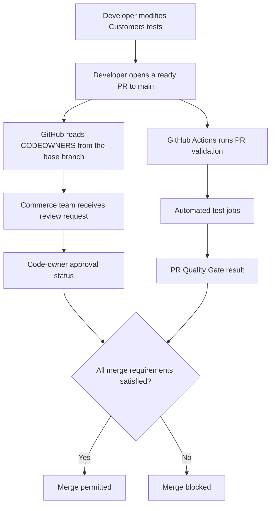

# 🚀 TestEcommerceAPI - Team & Entity Discovery Architecture Guide

> Documentation explaining how Business Entities, Teams, Logging, Allure, Fixtures, Runtime Resources, and CI Matrix execution work together.

---

# 📖 Table of Contents

1. Overview
2. Core Philosophy
3. Code ownership and reviews
4. Discovery Architecture
5. Entity Discovery (Test Ownership)
6. Framework Entity Discovery
7. Runtime Registry Discovery
8. EntityBundle Architecture
9. Entities Registry
10. Shared API Resources
11. Allure Ownership
12. Structured Logging
13. CI/CD Matrix Strategy
14. Adding a New Entity
15. Future Architecture Vision
16. Single Source of Truth

---

# 🎯 Overview

The framework is designed around a **Domain-Driven** Testing Architecture.

Each business entity has its own test directory and an explicit logical owner. A team can own several entities. Shared QA infrastructure supports every domain.

---

# 🏗️ Core Philosophy

For this framework:

```text
Business Entity
↓

Owning Team
↓

Logging

↓

Reporting

↓

CI Boundary
```

---

## 🛡️ Code ownership and reviews

### What is CODEOWNERS?

A `CODEOWNERS` file is a configuration file supported by Git hosting platforms such as GitHub and GitLab. It defines which individuals or teams are responsible for specific files or directories in a repository. This guide describes GitHub's behavior.

Its primary purposes are:

- **Automatic review requests:** GitHub requests reviews from the designated code owners when a ready pull request changes files covered by their rules. Draft PRs do not trigger automatic code-owner review requests until they are marked ready for review.
- **Required approvals:** Branch protection or rulesets can make approval from the applicable code owners a condition for merging.
- **Clear accountability:** The file documents who maintains different areas of the codebase.
- **Knowledge sharing and quality control:** Domain experts can review changes for correctness, maintainability and business behavior.

CODEOWNERS defines review responsibility, not file-level access permissions. It does not itself prevent contributors from modifying files, creating branches or opening PRs. Email delivery depends on the recipient's GitHub notification settings.

### Automatic reviews and mandatory approvals

Review assignment and merge enforcement are separate responsibilities.

| Mechanism | Responsibility |
|---|---|
| `.github/CODEOWNERS` | Identifies who should review the changed files. |
| **Require approvals** | Sets the minimum number of eligible approving reviewers. |
| **Require review from Code Owners** | Requires an eligible owner to approve changes to code-owned files. |
| **PR Quality Gate** | Aggregates the results of the mandatory automated PR validation jobs. |
| **Branch protection / Rulesets** | Enforces the configured merge requirements. |

Enabling **Require approvals** does not override CODEOWNERS. Automatic review requests still happen. To make the responsible owner's approval mandatory, enable **Require review from Code Owners**, independently of the general approval count.

For example, a developer changes Customers tests in a company where the Commerce team owns `tests/customers/` and the Catalog team is not a code owner for those files:

| Configuration | Is Commerce team approval mandatory? | Can a Catalog team member with write access approve instead? |
|---|---|---|
| CODEOWNERS only (no required reviews) | No | Approval is optional. |
| CODEOWNERS + Require approvals (1) | No | Yes, an eligible approval satisfies the count. |
| CODEOWNERS + Require review from Code Owners (general count 0) | Yes | No, an applicable owner must approve. |
| CODEOWNERS + Require approvals (1) + Require review from Code Owners | Yes | No, not without an applicable code-owner approval. |

With **Require approvals = No (0)** and **Require review from Code Owners = Yes**, only changes to owned files trigger a mandatory owner approval. Unowned files do not require a human approval under these two settings. However, this framework has a repository-wide `* @Kwakic` default rule, so every file is owned. Disabling the general count does not remove the mandatory review requirement for any PR in this ownership model.

A code-owner approval also counts toward the minimum number of approvals. If several owners are listed for the same path, approval from one eligible owner is sufficient for that path. A PR touching differently owned areas must satisfy the applicable ownership requirements.

These settings block **merging**, not opening a PR. The examples assume no bypass, blocking review, merge conflict or other unmet requirement.

### Pull request review workflow

Example: a multi-team repository where code-owner approval and the `PR Quality Gate` are both required for `main`.



Human review and automated validation can run in parallel. The reviewer examines the proposed changes; CI executes the tests; branch protection or rulesets determine whether merging is permitted. A green CI result does not substitute for a required human approval, and an approval does not substitute for passing CI.

### Enterprise governance target and solo-maintainer exception

**Recommended enterprise baseline:** require a PR, at least one eligible independent approval, approval from the applicable code owners, and the automated `PR Quality Gate`. Use complete ownership coverage and multiple eligible reviewers in each team. Protect the ownership registry, generator, CODEOWNERS and CI configuration under platform review. This combines a general review safety net with specialist accountability. Increase the number or independence of reviews for high-risk changes according to the organization's security and compliance policy.

| Setting | Recommended mature enterprise | Selective owner-only alternative | Solo-maintainer exception |
|---|---|---|---|
| CODEOWNERS file | Present | Present | Present |
| Require a pull request before merging | Yes | Yes | Yes |
| Require approvals | Yes (at least 1) | No (0) | No |
| Require review from Code Owners | Yes | Yes | No |
| Require status checks | Yes | Yes | Yes |
| Required check | `PR Quality Gate` | `PR Quality Gate` | `PR Quality Gate` |

The selective alternative is useful when an organization deliberately requires specialist review only for owned areas and accepts unowned changes without human approval. It still requires an owner for every PR in this framework because of the catch-all rule. Other configured merge requirements always apply.

All logical teams currently map to `@Kwakic`. A PR author cannot approve their own PR. Therefore, leave mandatory human approval disabled while there is no independent eligible reviewer, but retain CODEOWNERS and the required CI gate. This is an operational exception until the enterprise model can be enforced with real teams, not a reduction of the framework's governance target. The table describes recommended policies, not a live audit of GitHub settings.

For configuration and verification steps, see [GitHub production settings — Require review from Code Owners](../ci/README_GITHUB_PRODUCTION_SETTINGS.md#iii-require-review-from-code-owners). For GitHub's rules and syntax, see [About code owners](https://docs.github.com/en/repositories/managing-your-repositorys-settings-and-features/customizing-your-repository/about-code-owners).

### Framework ownership model

Each business entity has an explicit logical team. A team can own multiple entities, and the QA platform team maintains the common automation infrastructure. The framework registry is the source of truth for team assignments, criticality and review recipients; `.github/CODEOWNERS` is generated from that configuration.

| Scope | Accountable team | Responsibility |
|---|---|---|
| Customers | commerce team | Customer behavior and its domain tests |
| Products | catalog team | Catalog behavior and its domain tests |
| Orders | purchase team | Order behavior, including scenarios that use products, customers or coupons |
| Coupons | promo team | Coupon behavior and its domain tests |
| Shared infrastructure | QA platform | Shared clients, fixtures and tests, cross-domain UI journeys, seed and maintenance scripts, CI, reporting and framework documentation |

Domain ownership follows the entity's test folder, framework package (API clients, helpers, DAOs, validators and models), API pytest plugin, entity test-data builders, factories and provisioners, and team guide. The QA platform maintains common mechanisms such as the cleanup registry. Pytest's resource registry records which test data can be deleted. [Test data lifecycle](../development/README_TEST_DATA_ARCHITECTURE.md)

The framework registry holds the entity names, logical teams, criticality tiers and each team's GitHub review recipient. All five responsibilities currently route to the personal repository owner, `@Kwakic`. The logical names describe engineering responsibilities. GitHub routes review requests using the accounts in the generated file. [Ownership registry](../../EcommerceAPI/src/metadata/entity_metadata.py) · [CODEOWNERS](../../.github/CODEOWNERS)

The generated CODEOWNERS file places the shared default first and domain-specific patterns afterward. GitHub uses the last matching pattern, not necessarily the most specific one. The file must already exist on the PR's base branch for its rules to apply.

The existing shared PR unit lane checks that domain source directories, entity metadata and review rules agree. Matrix generation also rejects incomplete ownership. GitHub account existence, write access and team visibility must be verified on GitHub when assignments change. [Ownership tests](../../tests/shared/unit_tests/test_team_ownership.py)

### Read a CODEOWNERS rule

Suppose a pull request changes the Products DAO. GitHub looks at the file's path and applies the last matching rule in [CODEOWNERS](../../.github/CODEOWNERS).

```text
# products | catalog team
/EcommerceAPI/src/entities/products/ @Kwakic
```

The rule: the path on the left starts at the repository root, and the handle on the right identifies the GitHub reviewer. The trailing `/` covers **every file below that directory**, including files added later.

| Changed path | Which rule applies? |
|---|---|
| `dao/products_dao.py`, `helpers/products_helper.py`, `api/products_api.py`, `models/product_model.py`, or `validators/product_validators.py` under `EcommerceAPI/src/entities/products/` | The Products directory rule covers all five. A future `assertions/` folder under Products is covered too. |
| `EcommerceAPI/src/test_data/factories/products/product_factory.py` | The Products test-data rule, `/EcommerceAPI/src/test_data/*/products/`. The `*` matches a layer such as `factories`, `builders`, or `provisioning`. |
| `EcommerceAPI/plugins/api/products.py` | An exact file rule assigns this pytest plugin to Products. The Products test directory and team guide also have their own rules. |
| `EcommerceAPI/src/shared/assertions/common_assertions.py` or `EcommerceAPI/src/clients/api_client.py` | The repository-wide `*` rule assigns these files to the QA platform, even when a Products test uses them. |

In this portfolio, both the catalog team and the QA platform map to `@Kwakic`. That account is therefore the named reviewer for both a Products DAO change and a shared assertion change. The two logical responsibilities are distinct even though they currently resolve to the same GitHub account.

**When to regenerate.** Adding a file under an already covered directory needs no ownership edit. To change a team or its reviewer, edit the registry and follow the worked example below. If a new domain-owned location falls outside the existing rules, update the path patterns in `render_codeowners()`, regenerate with `--write`, and review the generated diff in the same PR. [Generator](../../.github/scripts/generate_codeowners.py)

### Assign two entities to one team

Suppose the commerce team already owns Customers and will also take responsibility for Products. Make the change on your feature branch. Run the commands below from the repository root with the project's Python environment active.

1. **Check the team name and reviewer.** Open the [ownership registry](../../EcommerceAPI/src/metadata/entity_metadata.py). In `ENTITY_METADATA`, Customers already uses `commerce team`. In `TEAM_REVIEWERS`, that team already maps to `@Kwakic`. Reuse the same spelling for Products. If you are assigning a genuinely new team, first add its name and verified GitHub reviewer to `TEAM_REVIEWERS`.

2. **Change the Products entry in `ENTITY_METADATA`.** Replace `catalog team` with `commerce team`. The resulting entry is shown below. Customers already has the desired owner.

   ```python
   "products": {
       "tier": "tier: high",
       "team": "commerce team",
   },
   ```

3. **Regenerate GitHub's review rules.** Run the generator after saving the registry. It writes [`.github/CODEOWNERS`](../../.github/CODEOWNERS) for you. Future runs overwrite hand edits to that file.

   ```bash
   python .github/scripts/generate_codeowners.py --write
   ```

4. **Verify both assignments.** The first command exits silently on success. Each matrix command should show `"team": "commerce team"` for the requested entity. The final command runs the shared ownership checks.

   ```bash
   python .github/scripts/generate_codeowners.py
   python .github/scripts/generate_matrix.py --entity customers
   python .github/scripts/generate_matrix.py --entity products
   python -m pytest tests/shared/unit_tests/test_team_ownership.py -q
   ```

5. **Review the change and include both files in the same pull request.** Check the registry and generated rules together. In this portfolio, the Products heading becomes `# products | commerce team`. Both teams route to `@Kwakic`, so the reviewer lines still show that account. In an organization where the teams have different GitHub handles, the Products reviewer lines also change. Update the ownership table above when making an actual transfer.

   ```bash
   git diff -- EcommerceAPI/src/metadata/entity_metadata.py .github/CODEOWNERS
   ```

---

# 🏛️ Framework Discovery Architecture

The framework contains **three independent discovery mechanisms**.

Each one answers a different architectural question.

| Discovery | Question | Consumers |
|------------|----------|-----------|
| Entity Discovery | **Which entity does this test belong to?** | Logging, Allure, Reporting |
| Framework Entity Discovery | **What business domains belong to this framework?** | CI Matrix, Contract, Security, Documentation |
| Runtime Registry Discovery | **Build executable runtime resources.** | Fixtures, EntityBundle, Cross-domain access |

Although these mechanisms are independent, they all ultimately resolve to the same business entity.

---

### 🔎 Discovery Responsibilities

Although the three discovery mechanisms are independent, they each have a
single responsibility and collaborate to provide a complete testing
architecture.

```text
                    entity_metadata.py
                           │
                           ▼
             discover_framework_entities()
                           │
          ┌────────────────┼────────────────┐
          ▼                ▼                ▼
 GitHub Actions Matrix   Contract       Security
          │
          ▼
 Automatic Pytest Markers


                    entity_discovery.py
                           │
                           ▼
          extract_entity_from_nodeid()
                           │
          ┌────────────────┼────────────────┐
          ▼                ▼                ▼
      Logging          Allure          Reporting
                           │
                           ▼
 Automatic Pytest Markers


                     plugins/entities.py
                           │
                           ▼
                 discover_entities()
                           │
                           ▼
                     Runtime Registry
                           │
          ┌────────────────┼────────────────┐
          ▼                ▼                ▼
     EntityBundle     Shared Fixtures   Cross-Entity Access
```

### Responsibilities

| Component | Responsibility | Primary Consumers |
|-----------|----------------|-------------------|
| `entity_discovery.py` | Identifies the business entity or shared scope of a test from its pytest nodeid. | Logging, Allure, Reporting, Automatic pytest marker assignment |
| `entity_metadata.py` | Defines the registered business entities and their logical ownership metadata. | GitHub Actions Matrix, Contract, Security, Documentation, Automatic pytest marker validation |
| `plugins/entities.py` | Builds executable runtime resources for implemented entities. | EntityBundle, Shared Fixtures, Cross-Entity Helpers, Automatic Cleanup |

This separation follows the framework's **Single Responsibility Principle**:

- **Entity Discovery** answers **"Which entity does this test belong to?"**
- **Framework Entity Discovery** answers **"Which entities exist in this framework?"**
- **Runtime Registry Discovery** answers **"Build the runtime resources for those entities."**

Although these mechanisms are independent, they all ultimately resolve to the same business entity and work together during test execution.

Example:

```text
customers
```

represents:

- Business entity (Customers domain)
- CI execution and reporting boundary
- Entity assigned to the commerce team through the framework registry

A business domain is not necessarily a separately deployed microservice, and it is not the same as its owning team.

---

# 1. 🔍 Entity Discovery (Test Ownership)

**Source**

```text
src/utils/entity_discovery.py
```

Entity Discovery identifies **which business entity or shared scope a test belongs to**.

The framework derives the entity directly from the pytest nodeid.

Example

```text
tests/customers/api/test_create_customer.py
                    │
                    ▼
extract_entity_from_nodeid()
                    │
                    ▼
               customers
```

The convention is intentionally simple:

```text
tests/<entity>/...
```

The first directory immediately below `tests/` determines the entity.

Examples

| Test Path | Entity |
|-----------|---------|
| tests/customers/api/test_x.py | customers |
| tests/orders/api/test_x.py | orders |
| tests/products/api/test_x.py | products |
| tests/shared/preflight/test_x.py | shared |

### Purpose

This discovery mechanism identifies **entity-level ownership**. The framework registry maps business entities to their responsible teams; the current Allure `team` label still contains entity names.

It is used by:

- Structured logging
- Allure reporting
- Reporting
- Future notifications

It does **not** inspect the framework implementation and performs no runtime initialization.

---

# 2. 🗂️ Framework Entity Discovery

**Source**

```text
src/metadata/entity_metadata.py
```

Framework Entity Discovery defines **which business domains officially belong to the framework**.

Unlike runtime discovery, it does **not** inspect helpers, APIs or DAOs.

Instead, the framework maintains an explicit architectural registry.

```python
FRAMEWORK_ENTITIES = (
    "customers",
    "orders",
    "products",
    "coupons",
)
```

The registry is intentionally explicit.

Adding a new business entity is considered an architectural change and therefore becomes visible during code review.


### Purpose

Framework Entity Discovery is consumed by:

- GitHub Actions matrix generation
- Contract test suites
- Security test suites
- Documentation

This registry represents **framework architecture**, not runtime implementation.

> **Naming convention**
>
> Framework entity identifiers are lowercase, plural domain
> identifiers without hyphens (for example `customers`, `orders`,
> `products`, `coupons`).
>
> This convention is relied upon by the CI/CD workflows when constructing
> artifact names and GitHub Pages report paths.
>
> Introducing hyphens into entity identifiers would require updating the
> artifact naming and parsing strategy.

---

# 3. ⚙️ Runtime Registry Discovery

**Source**

```text
plugins/entities.py
```

Runtime Registry Discovery builds the executable resources required during test execution.

Unlike Framework Entity Discovery, it performs runtime initialization.

For every implemented entity it creates:

```text
API Client
      │
      ▼
API
      │
      ▼
Helper
      │
      ▼
DAO
      │
      ▼
EntityBundle
```

Every successfully initialized entity is wrapped into an **EntityBundle** and registered in the runtime registry.

Tests can then access entities through a single unified interface.

Example:

```python
all_resources.customers.helper

entity_helper("customers")

entity_dao("customers")
```

### Runtime validation

During initialization the framework validates that every runtime component exists.

Entities that cannot be initialized are skipped and reported.

Example:

```text
🔍 ENTITY DISCOVERY SUMMARY

customers   READY
orders      SKIPPED (missing API)
products    SKIPPED (missing DAO)
coupons     SKIPPED (missing API)
```

This diagnostic information is produced during runtime registry construction and greatly simplifies troubleshooting.

---

# 📦 EntityBundle Architecture

Each discovered entity becomes:

```python
EntityBundle(
    helper,
    dao,
    delete_method
)
```

Example:

```python
customers
```

becomes:

```python
EntityBundle(
    helper=CustomersHelper,
    dao=CustomersDAO,
    delete_method=CustomersApi.delete
)
```

---

# ✅ Runtime Implementation Requirements

Required modules:

```text
<entity>_helper.py
<entity>_api.py
<entity>_dao.py
```

Example:

```text
customers_helper.py
customers_api.py
customers_dao.py
```

If any component is missing:

❌ Entity skipped

The framework logs the reason.

---

# 🗂️ Entities Registry

Source:

```text
entities_registry.py
```

Purpose:

Wrap discovered entities.

Supports:

Dictionary access:

```python
entities["customers"]
```

Attribute access:

```python
entities.customers
```

Benefits:

- Cleaner syntax
- Better readability
- Type-safe access
- Centralized registry

---

# 🔗 Shared API Resources

Fixture:

```python
shared_api_resources
```

Provides:

- Helpers
- DAOs
- API Clients
- Explicit resource ownership registration
- Cleanup integration

### Resource ownership and cleanup

The fixture uses `ResourceOwnershipRegistry` to record resources that were
**explicitly created and registered by the current fixture lifecycle**.

```text
Test / Fixture
      │
      │ register_resource("customers", customer_id)
      ▼
ResourceOwnershipRegistry
      │
      │ identifies owned resources
      ▼
Existing entity cleanup
      │
      │ delete_method
      ▼
cleanup_items()
```

The ownership registry is responsible for **ownership state**, not deletion.
The existing `cleanup_items()` implementation remains responsible for the
actual deletion operation.

This distinction is intentional:

- A resource is cleaned only when it was explicitly registered.
- Duplicate registration is ignored.
- A resource already deleted during the test can be marked as deleted.
- Seeded/shared resources are not automatically claimed as owned.
- Actual deletion continues to use the framework's existing cleanup mechanism.

The current `shared_api_resources` fixture remains **module-scoped**, so its
ownership registry is also associated with the module-level fixture lifecycle.
This change does not alter the existing cleanup scope.

Examples:

```python
shared_api_resources["customers_helper"]
```

or

```python
all_resources.customers.helper
```

---

# 🎭 UI Test Resource Cleanup

UI tests have a dedicated `ui_resources` fixture because UI-created
application resources require **function-scoped cleanup**.

The fixture:
- tracks only resources explicitly created by the current UI test
- cleans those resources at the end of that test
- reuses the framework's standard `cleanup_items()` deletion mechanism
- never discovers or deletes seeded/shared UI data automatically

This is intentionally different from the current API resource lifecycle,
where `shared_api_resources` is module-scoped.

The ownership model is the same in principle:

    UI test
        ↓
    explicit resource registration
        ↓
    UI resource lifecycle
        ↓
    cleanup_items()
        ↓
    entity delete method

The UI-specific fixture exists to preserve function-level isolation while
the framework's ownership architecture continues to evolve toward a
common ownership model.


---

# 🤝 Cross-Team Access

One team can access another entity safely.

Example:

```python
entity_helper("customers")
```

allows:

```text
orders tests
    ↓
customer helper
```

without importing customer fixtures directly.

Benefits:

- No fixture leakage
- Better encapsulation
- Cleaner dependency management

---

# 📊 Allure Ownership Tracking

Source:

```text
allure_autogen.py
```

The current Allure `team` label uses the entity extracted from the test path. The CI matrix uses the owning team from the registry. Use the registry and CODEOWNERS for review decisions.

Example:

```text
tests/customers/...
            ↓
        customers
```

Executed entity names are collected during runtime.

Example:

```text
customers
orders
products
```

Allure Environment Tab receives:

```text
teams=customers,orders,products
```

automatically.

---

# 📝 Structured Logging

Source:

```text
log_context.py
```

Context Variables:

```python
correlation_id
test_nodeid
```

Ownership Flow:

```text
test_nodeid
     ↓
entity discovery
     ↓
entity ownership
     ↓
log routing
```

Example:

```text
reports/logs/customers/
reports/logs/orders/
reports/logs/products/
reports/logs/coupons/
```

---

# 🧪 Test Ownership vs Entity Registration

Important:

Creating:

```text
tests/customers/
```

does NOT register an entity.

Entity registration requires:

```text
customers_helper.py
customers_api.py
customers_dao.py
```

Therefore:

Test ownership and runtime entity registration are related but technically independent.

---

# ⚙️ CI/CD Matrix Strategy

CI builds its execution matrix from the framework registry. The manual
dispatch form lists the entity choices for developers. When adding an entity,
update the form in `.github/workflows/manual-entity-tests.yml` as well.
The manual workflow checks the choices against the registry before starting
test jobs. [Run an entity suite on demand](../ci/README_CI_ARCHITECTURE.md#run-an-entity-suite-on-demand)

```text
FRAMEWORK_ENTITIES
        │
        ▼
discover_framework_entities()
        │
        ▼
generate_matrix.py
        │
        ▼
GitHub Actions Matrix
```

Every supported business entity automatically participates in:

- Smoke
- Integration
- Regression
- Performance

Shared framework suites (Preflight, Contract and Security) execute independently from the entity matrix.

This keeps CI aligned with the framework architecture while avoiding duplicated configuration across workflows.

---

# 🚦 CI Ownership Model

Each matrix entry represents:

```text
customers
    ↓
Entity
    ↓
Owning Team
    ↓
Deployment Boundary
    ↓
Reporting Boundary
```

This is why:

```yaml
entity: customers
```

is much more than simply selecting tests.

---

# ➕ Adding a New Entity

Introducing a new business entity is an architectural change.

1. Add the domain to `FRAMEWORK_ENTITIES` and set its `team` in `ENTITY_METADATA`. Set a tier if the default does not apply. For an existing domain, follow the [worked example for transferring ownership](#assign-two-entities-to-one-team).
2. For a new team, add one `TEAM_REVIEWERS` entry. In an organization, choose a visible team with explicit repository write access. Confirm the account on GitHub before assigning it.
3. Add the domain implementation, tests, documented pytest marker, team guide, and entity choice in `.github/workflows/manual-entity-tests.yml`. Follow the existing runtime helper and DAO discovery conventions.
4. From the repository root regenerate the review rules, inspect the diff, and run the shared checks. Include the registry and generated file together in the PR.

```bash
python .github/scripts/generate_codeowners.py --write
git diff -- .github/CODEOWNERS
python .github/scripts/generate_codeowners.py
python -m pytest tests/shared/unit_tests/test_team_ownership.py tests/shared/unit_tests/test_manual_entity_selection.py -q
```

---

# 🔮 Future Evolution

The registry supplies entity, team and tier to the CI matrix. Future uses include the following.

- 📣 Slack notifications
- 🔁 Selective retries
- 🚧 Deployment gates
- 🧪 Flaky-test quarantine
- 📊 Team dashboards


---
# 🚀 Dynamic CI Matrix

The framework owns entity discovery.

GitHub Actions consumes that information rather than maintaining its own list of entities.

Architecture:

```
FRAMEWORK_ENTITIES
        │
        ▼
discover_framework_entities()
        │
        ▼
generate_matrix.py
        │
        ▼
GitHub Actions Matrix

```

New registered entities automatically join the full CI matrix. Add each new
name to the manual dispatch dropdown so a team can select it individually.

---

# 🎯 Single Source of Truth Vision

Today ownership and execution are intentionally separated.

```
Ownership

↓

extract_entity_from_nodeid()

Framework

↓

FRAMEWORK_ENTITIES

Runtime

↓

discover_entities()
```

---

# 🏁 Summary

The framework intentionally separates three different discovery mechanisms.

## 1. Entity Discovery

Identifies **which entity or shared scope a test belongs to**.

Used by:

- Logging
- Allure
- Reporting

---

## 2. Framework Entity Discovery

Determines **which business domains belong to the framework**.

Used by:

- CI Matrix
- Contract
- Security
- Documentation

---

## 3. Runtime Registry Discovery

Builds executable runtime resources.

Used by:

- EntityBundle
- Shared fixtures
- Cross-domain helpers
- Automatic cleanup

---

Together these mechanisms provide a clear separation between:

- **Test ownership**
- **Framework architecture**
- **Runtime execution**

This separation keeps the framework maintainable, scalable and suitable for multi-team development while avoiding
duplicated configuration and hidden runtime behaviour.
